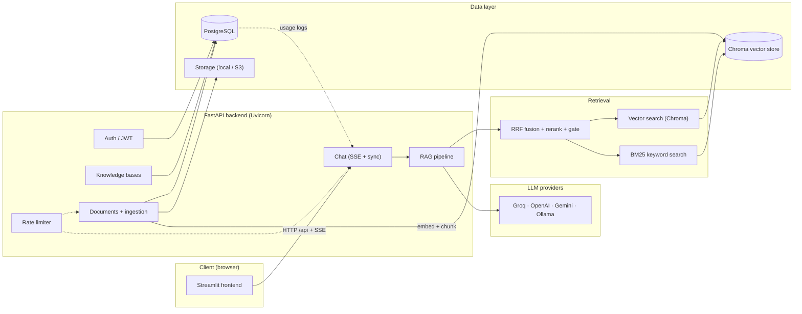

# Multi-User RAG Platform

A production-oriented, **multi-user Retrieval-Augmented Generation (RAG)**
platform: authenticated users curate private knowledge bases, upload documents,
and ask questions that are answered **from their own documents only** — with
citations, token usage tracking, and a similarity gate that refuses to answer
out-of-scope questions.

Built with **FastAPI + PostgreSQL + ChromaDB + Streamlit**, containerized with
Docker Compose, shipped with CI/CD, RAGAS evaluation tooling, and a
step-by-step AWS deployment guide.

---

## ✨ Features

- **Multi-user auth** — JWT access + rotating refresh tokens, bcrypt (work
  factor 12), per-user data isolation enforced at every layer (API, ORM,
  vector store).
- **Knowledge bases** — create multiple private KBs per user; every document,
  chunk, chat session and usage log is scoped to its owner.
- **Document ingestion** — upload PDF / DOCX / TXT / MD, recursive
  chunking with overlap and full provenance metadata (file, page span,
  chunk index), duplicate detection via content hash, background ingestion.
- **Hybrid retrieval** — dense vector search (BGE embeddings) + BM25 keyword
  search + Reciprocal Rank Fusion, with optional cross-encoder reranking and a
  similarity gate (skip the LLM when nothing relevant is found).
- **Chat with citations** — streaming (SSE) and non-streaming answers; model
  citations like `[quarterly_report.pdf, p.3]` are parsed and resolved to the
  exact retrieved chunks; multi-turn history with query rewriting.
- **Observability** — structured JSON logging, `/health/live` + `/health/ready`
  probes, token usage logs per answer.
- **Storage flexibility** — local disk or S3 (boto3), selected by
  `STORAGE_BACKEND` with no call-site changes.
- **Evaluation tooling** — dataset builder, RAGAS runner (faithfulness,
  answer relevancy, context precision, context recall) and a retrieval
  config comparator (vector vs hybrid vs hybrid+rerank × chunk sizes).
- **Deployment** — multi-stage non-root Docker images, Compose dev + prod
  overrides, Nginx HTTPS reverse proxy, GitHub Actions CI + ECR/EC2 CD, and a
  complete AWS deployment guide with cost estimates.

## 🏗️ Architecture



**Request flow:** the browser talks to the Streamlit frontend, which calls the
FastAPI API. The chat endpoint runs the RAG pipeline: query rewriting → vector
search + BM25 → RRF fusion → optional reranking → similarity gate → LLM
generation with the retrieved context → citation extraction. All vector-store
queries are filtered by `user_id`, so one user can never retrieve another's
documents.

## 🧱 Tech stack

| Layer | Choice | Notes |
| --- | --- | --- |
| Backend | Python 3.11 · FastAPI · Uvicorn | async SQLAlchemy 2.0, Pydantic v2 |
| Database | PostgreSQL 15 | UUID PKs, JSONB, CITEXT emails |
| Vector store | ChromaDB | 1 collection per KB, user-scoped filters |
| Embeddings | sentence-transformers (BGE small) | cached Docker layer, offline-ready |
| Retrieval | BM25 + RRF + cross-encoder rerank | hybrid, configurable per KB |
| LLM | Groq / OpenAI / Gemini / Ollama | provider chosen via env var |
| Frontend | Streamlit 1.40 | SSE consumer, JWT refresh handling |
| Orchestration | Docker Compose (+ prod override) | healthchecks, volumes, non-root images |
| CI/CD | GitHub Actions | lint · type-check · test · build · ECR/EC2 deploy |
| Evaluation | RAGAS | faithfulness, relevancy, precision, recall |

## 🚀 Setup

### Local (development)

```bash
# 1. Backend
cd backend
python -m venv .venv && source .venv/bin/activate
pip install -r requirements.txt
cp .env.example .env          # then set JWT_SECRET, LLM keys, etc.
uvicorn app.main:app --reload --port 8000

# 2. Frontend
cd ../frontend
python -m venv .venv && source .venv/bin/activate
pip install -r requirements.txt
streamlit run app.py --server.port=8501

# 3. Infrastructure (Postgres + Chroma)
cd ..
docker compose up -d postgres chromadb
```

Open http://localhost:8501, register a user, create a knowledge base, upload a
document and start chatting. The backend serves OpenAPI docs at
http://localhost:8000/docs.

> **LLM provider:** set `LLM_PROVIDER` and the matching API key in `backend/.env`
> (e.g. `GROQ_API_KEY`). Without a key the app still runs; retrieval works and
> chat answers will surface a clear provider error.

### Docker (full stack)

```bash
cp backend/.env.example backend/.env   # fill in real values
docker compose up -d --build
```

This brings up Postgres, Chroma, the backend and the Streamlit frontend with
correct healthchecks and dependencies.

### Production

```bash
# Prod overrides: restart policies, resource limits, JSON logs, S3 uploads
JWT_SECRET=$(openssl rand -base64 48) \
docker compose -f docker-compose.yml -f docker-compose.prod.yml up -d
```

See **[docs/08-aws-deployment.md](docs/08-aws-deployment.md)** for the full AWS
walkthrough (EC2 sizing, security groups, SSM secrets, HTTPS with Let's
Encrypt, S3 uploads, cost table and scaling plan).

## 📡 API summary

All endpoints are under `/api` and require a bearer token unless noted.

| Method | Path | Purpose |
| --- | --- | --- |
| `POST` | `/auth/register` | Register (email + password) → token pair |
| `POST` | `/auth/login` | Log in → token pair |
| `POST` | `/auth/refresh` | Rotate a refresh token |
| `GET` | `/auth/me` | Current user profile |
| `GET` | `/health/live` · `/health/ready` | Liveness / readiness (no auth) |
| `GET` · `POST` | `/knowledge-bases` | List / create knowledge bases |
| `GET` · `PATCH` · `DELETE` | `/knowledge-bases/{id}` | Fetch / rename / delete a KB |
| `POST` | `/knowledge-bases/{id}/documents` | Upload a document (multipart) |
| `GET` | `/knowledge-bases/{id}/documents` | List documents in a KB |
| `GET` · `DELETE` | `/documents/{id}` | Fetch / delete a document |
| `POST` | `/chat/sessions` | Create a chat session |
| `GET` · `DELETE` | `/chat/sessions/{id}` · `/chat/sessions/{id}/messages` | Session + message history |
| `POST` | `/chat/sessions/{id}/ask` | **Stream** an answer as SSE (`rewrite`, `citation`, `token`, `done`) |
| `POST` | `/chat/sessions/{id}/ask-sync` | Non-streaming answer (test clients) |

Full interactive docs: `http://localhost:8000/docs` (Swagger UI) and
`/openapi.json`.

## 📊 Evaluation results

Evaluation tooling lives in [`evaluation/`](evaluation/):

| Script | Purpose |
| --- | --- |
| `build_dataset.py` | Builds 25 Q/A/ground-truth triples from sample PDFs + writes a manual template |
| `run_ragas.py` | RAGAS metrics (faithfulness, answer relevancy, context precision, recall) with a results table |
| `compare_configs.py` | Vector vs hybrid vs hybrid+rerank × chunk sizes, recall/MRR/nDCG/latency table |

```bash
# 1. Drop sample PDFs in evaluation/datasets/sample_pdfs and build the dataset
python evaluation/build_dataset.py

# 2. Run RAGAS (needs ragas, a running Chroma, and an LLM key)
pip install ragas==0.2.12
python evaluation/run_ragas.py --pdf-dir evaluation/datasets/sample_pdfs

# 3. Compare retrieval configurations
python evaluation/compare_configs.py
```

### RAGAS results

> *Placeholder — fill in after running `evaluation/run_ragas.py`.*

| Metric | Score |
| --- | --- |
| Faithfulness | `_todo_` |
| Answer relevancy | `_todo_` |
| Context precision | `_todo_` |
| Context recall | `_todo_` |

### Retrieval configuration comparison

> *Placeholder — fill in after running `evaluation/compare_configs.py`.*

| Config | Chunk Size | Recall@5 | Recall@10 | MRR | nDCG@10 | Latency (ms) |
| --- | --- | --- | --- | --- | --- | --- |
| vector-only | 400 | `_todo_` | `_todo_` | `_todo_` | `_todo_` | `_todo_` |
| vector-only | 800 | `_todo_` | `_todo_` | `_todo_` | `_todo_` | `_todo_` |
| vector-only | 1200 | `_todo_` | `_todo_` | `_todo_` | `_todo_` | `_todo_` |
| hybrid | 400 | `_todo_` | `_todo_` | `_todo_` | `_todo_` | `_todo_` |
| hybrid | 800 | `_todo_` | `_todo_` | `_todo_` | `_todo_` | `_todo_` |
| hybrid | 1200 | `_todo_` | `_todo_` | `_todo_` | `_todo_` | `_todo_` |
| hybrid+rerank | 400 | `_todo_` | `_todo_` | `_todo_` | `_todo_` | `_todo_` |
| hybrid+rerank | 800 | `_todo_` | `_todo_` | `_todo_` | `_todo_` | `_todo_` |
| hybrid+rerank | 1200 | `_todo_` | `_todo_` | `_todo_` | `_todo_` | `_todo_` |

## 📸 Screenshots

> *Placeholder — drop demo screenshots in here (see
> [docs/09-demo-script.md](docs/09-demo-script.md) for the recording walkthrough).*

| Page | Screenshot |
| --- | --- |
| Login / Register | `_todo_` |
| Knowledge bases | `_todo_` |
| Document upload | `_todo_` |
| Chat with citations | `_todo_` |
| Settings | `_todo_` |

## 🧪 Testing

```bash
cd backend
pytest -q
```

- **Unit tests** cover the pure pipeline pieces (chunking, loaders, retrieval
  primitives, retry/backoff, prompts, schemas) and run without any services.
- **Integration tests** (`tests/test_integration_e2e.py`) run the full user
  journey against a real PostgreSQL database (auto-skipped when no test
  database is reachable; CI provides one).
- **Security tests** (`tests/test_security_isolation.py`) cover JWT hardening,
  storage path traversal, rate limiting, retrieval-level user scoping and
  cross-user isolation across KBs, documents and chat sessions.

Lint and type checks:

```bash
ruff check app tests
mypy app
```

## ⚖️ Limitations

- **Single-instance Postgres/Chroma** — the default deployment runs
  Postgres and Chroma as containers on one host; high-availability requires
  RDS / managed vector store (see the deployment guide's scaling section).
- **In-memory rate limiting** — the default limiter is process-local;
  multi-worker deployments should swap in a Redis-backed `RateLimiter`
  (interface is ready for it).
- **Background ingestion** — document ingestion runs in-process via FastAPI
  background tasks; very large document sets or hard reliability requirements
  would move to a task queue (Celery/Redis).
- **English-centric tooling** — the embedding model and chunking are tuned for
  English documents; other languages need a multilingual model swap.
- **No OCR** — scanned PDFs without a text layer are detected and rejected
  with a clear error.

## 🗺️ Future work

- Redis-backed rate limiting and caching (interface already abstracted).
- Celery/Redis task queue for ingestion and async pipelines.
- RDS + managed vector store (Bedrock Knowledge Bases / OpenSearch) for HA.
- ECS/Fargate deployment with an application load balancer.
- Multilingual embeddings and OCR pipeline for scanned documents.
- Query analytics dashboard (latency, token usage, gate-rejection rate).

## 📁 Repository layout

```
.
├── backend/              # FastAPI app: API, services, models, migrations
├── frontend/             # Streamlit app + API client
├── evaluation/           # Dataset builder, RAGAS runner, config comparator
├── deploy/               # Nginx reverse proxy config
├── docs/                 # Design spec, per-phase guides, AWS deploy guide
├── .github/workflows/    # CI (lint/type/test/build) + CD (ECR/EC2)
└── docker-compose.yml    # Dev + prod orchestration
```

## 📄 License

Provided as-is for educational and evaluation purposes.
